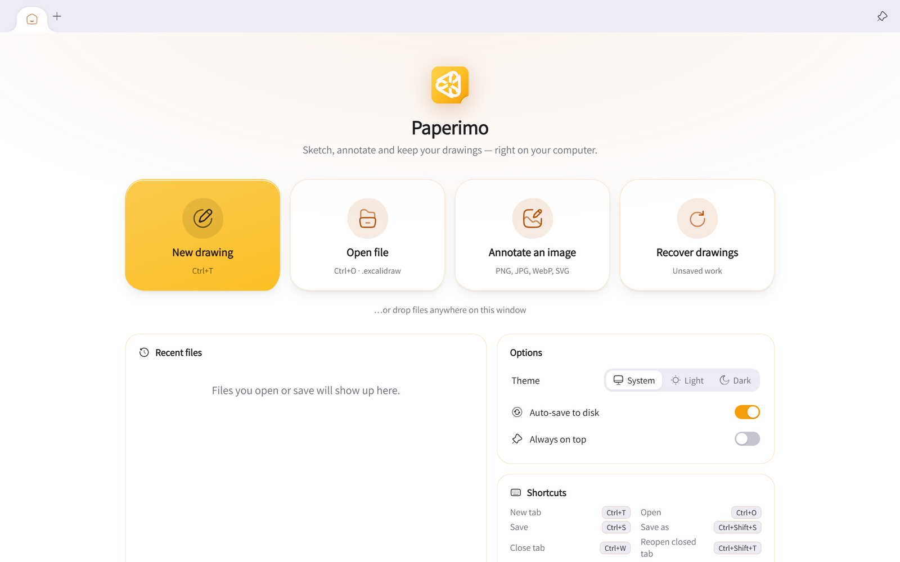
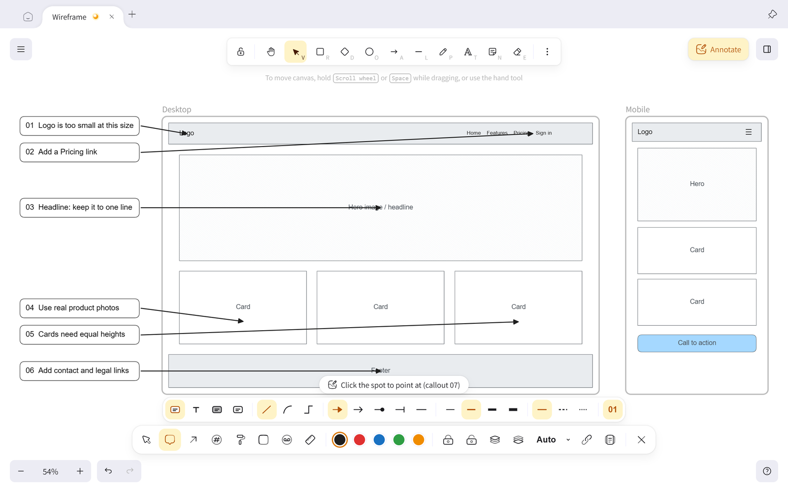
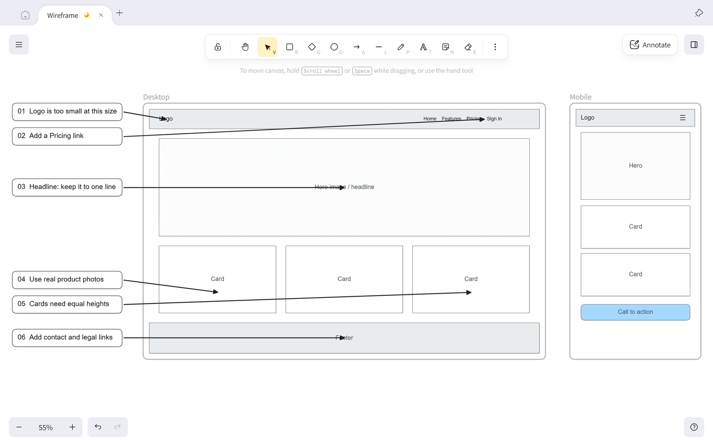
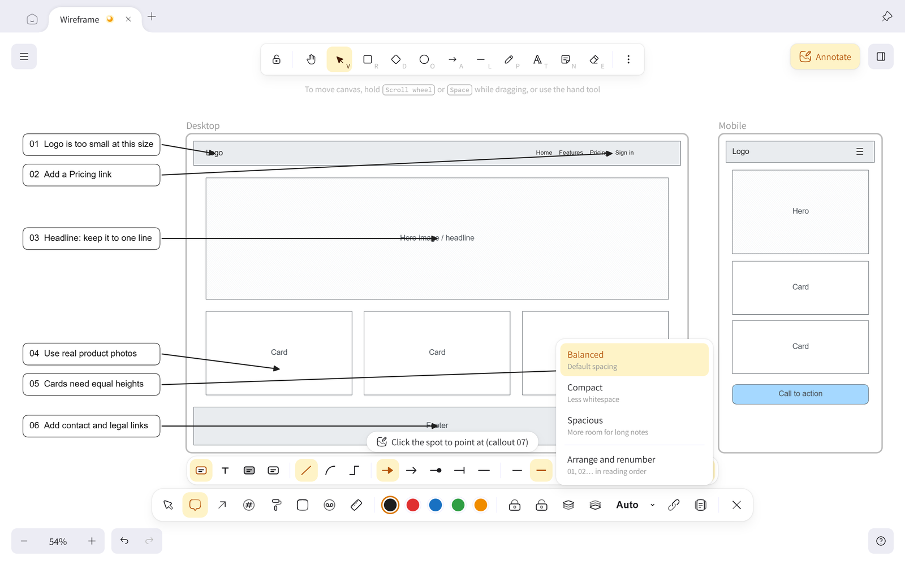
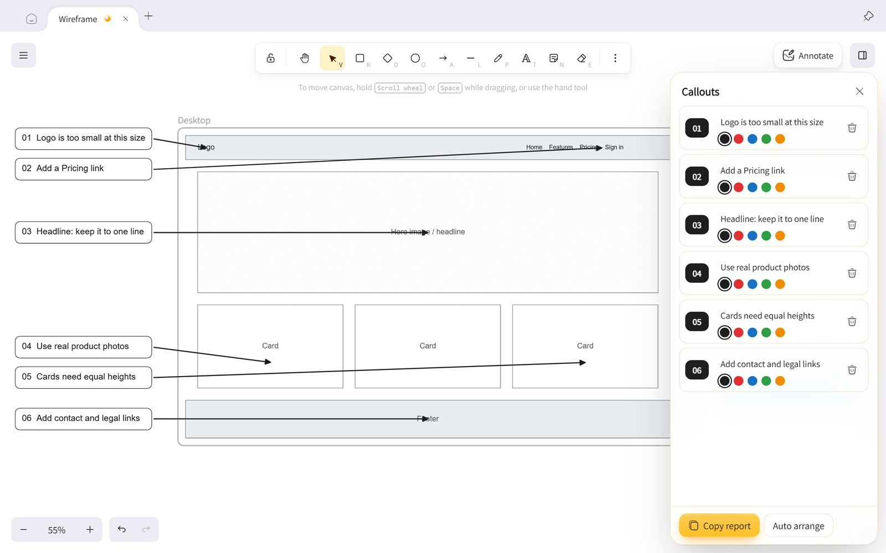
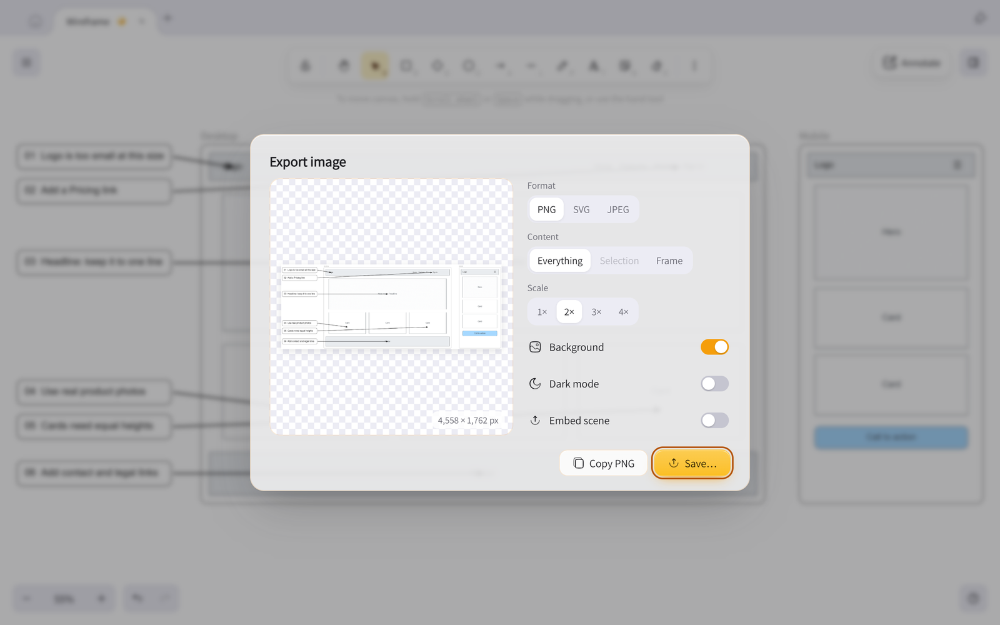

# Paperimo user guide

A walk through everything Paperimo does, with screenshots. New here? Start with
[Getting started](#getting-started), then [Annotate a screenshot](#annotate-a-screenshot).

- [Getting started](#getting-started)
- [Tabs and files](#tabs-and-files)
- [Annotate a screenshot](#annotate-a-screenshot)
  - [Callouts](#callouts)
  - [Editing callouts and arrows](#editing-callouts-and-arrows)
  - [Auto arrange](#auto-arrange)
  - [The Callouts panel and reports](#the-callouts-panel-and-reports)
  - [Other annotate tools](#other-annotate-tools)
- [Export](#export)
- [Present](#present)
- [Find things](#find-things)
- [Updates](#updates)
- [Where your data lives](#where-your-data-lives)
- [Troubleshooting](#troubleshooting)

## Getting started

When Paperimo starts with no drawings open, you get the Home screen.



- **New drawing** (Ctrl+T) opens an empty tab.
- **Open file** (Ctrl+O) opens `.excalidraw` drawings. Double-clicking one in File Explorer opens it here too.
- **Annotate an image** opens a PNG, JPG, WebP or SVG ready to mark up.
- **Recover drawings** shows unsaved work left over from a crash.
- **Options:** theme (System, Light, Dark), auto-save to disk, and always on top.

You can also drop files anywhere on the window: drawings open in tabs, images land where you drop
them, and `.excalidrawlib` files go into your library.

The drawing canvas is the real Excalidraw. Every tool, shortcut and menu works as on excalidraw.com,
and your files open there too.

## Tabs and files

- **Ctrl+T** new tab, **Ctrl+W** close, **Ctrl+Shift+T** reopen the tab you just closed.
- **Ctrl+Tab** and **Ctrl+1…9** switch tabs. Drag tabs to reorder; double-click a tab to rename its file;
  right-click to pin it.
- **Ctrl+S** saves to the file; **Ctrl+Shift+S** saves a copy elsewhere. With auto-save on (the default),
  files save themselves a moment after you stop drawing.
- Every tab keeps its own undo history.
- **Never lose work:** every change is also kept in recovery about once a second. If the app or your PC
  crashes, the next start brings every tab back, saved or not.
- **Changed on disk?** If you had no unsaved changes, the tab reloads quietly. Otherwise you choose: keep
  yours, load theirs, or save yours as a copy.
- **File history** (Ctrl+Shift+H) keeps the last 10 versions of each file, with thumbnails. Restoring opens
  the old version in a new tab, so nothing is overwritten until you save.

## Annotate a screenshot

Press **Ctrl+Shift+A** or the **Annotate** button (top right). The annotate bar appears at the bottom.
With a screenshot on the clipboard, **Ctrl+Shift+V** opens it in a new tab, locked as the background,
with annotate mode already on.



The bottom bar, left to right: **Select**, **Callout**, **Arrow**, **Number marker**, **Highlight**,
**Box**, **Circle**, **Measure**; the colours; lock / unlock the background image, send back / bring
forward; **Auto** arrange; **Select callout pair**; **Copy report**; and close.

The row above it shows the defaults for the current tool. They only apply to new annotations; anything
already drawn is edited with Excalidraw's own style panel.

### Callouts

1. Pick **Callout**.
2. Click the spot you want to point at.
3. Move the mouse: a preview of the label and arrow follows it. Click where the label should go.
4. Type the label. **Shift+Enter** adds a line; **Enter** places it.

By default a callout is a white label with dark text and a black arrow, numbered `01`, `02`, … In dark
mode the colours flip: dark label, light text, white arrow.

Callout options in the row above the bar:

| Option | Choices |
| --- | --- |
| Label | White · text only (no background) · tinted · outline |
| Arrow | Straight · curved · elbow |
| Arrowhead | Triangle · arrow · dot · bar · none |
| Line | 1, 2, 4 or 6 px · solid, dashed or dotted |
| **01** | Numbering on or off |

### Editing callouts and arrows

Everything annotate makes is an ordinary Excalidraw element, so you edit it the usual way. Press
**V** (or **Select**) to edit without leaving annotate mode:

- Click a **callout's arrow** to select just the arrow. Drag its middle handle to bend it, drag the ends
  to re-point it, and change its head, thickness, line style or colour in the style panel.
- **Move the label** and its arrow follows.
- **Double-click the label** to change its text.
- **Select callout pair** selects a label together with its arrow, so they move as one.
- Delete an arrow and the label stays. Delete a label and Paperimo offers to delete its arrow too.
- **Ctrl+Z** undoes a whole callout in one step.

### Auto arrange

Place labels wherever is quick, then press **Auto**. Paperimo lines the labels up into tidy columns
beside the picture, evenly spaced and with matching widths, with arrows that don't cross:



- What you pointed at never moves, and neither does anything else: only the labels and their arrows do.
- Labels go to the side nearest what they point at. If something else is in the way (like the mobile
  frame above), they use a free side. When a side is full, labels also go above and below.
- Long labels wrap; your numbers are kept.
- It's one undo step. The message at the top has an **Undo** button too.

The small arrow next to **Auto** has more:



- **Balanced** (default), **Compact** (less whitespace) or **Spacious** (more room for long notes).
- **Arrange and renumber** also renumbers `01, 02, …` in reading order (top to bottom, left column first).
  Plain **Auto** never renumbers, because numbers may already be quoted somewhere.

Auto measures shapes; it can't see what's inside a picture. That's why it keeps labels off the image
altogether.

### The Callouts panel and reports

Open it from the main menu (**Callouts…**) or the command palette.



- Click a callout to jump to it; edit its text; change its colour; delete it.
- **Renumber** closes gaps after deleting.
- **Copy report** copies every label as a numbered list, ready for a bug ticket or review email:

  ```
  01  Logo is too small at this size
  02  Add a Pricing link
  03  Headline: keep it to one line
  ```

- **Auto arrange** does the same as the Auto button.

### Other annotate tools

- **Arrow:** drag from start to tip. A normal Excalidraw arrow with your chosen defaults.
- **Number marker:** click to drop a numbered circle (1, 2, 3, …).
- **Highlight:** drag over an area for a soft yellow highlight (or the chosen colour).
- **Box** and **Circle:** drag to outline an area. Hold **Shift** for a square or circle.
- **Measure:** drag between two points to get a dimension line with its length. On a photo it reports
  the image's own pixels. Hold **Shift** for 45° steps.
- **Lock background** locks the screenshot so you can't move it by accident; **Unlock** frees it again.
- **C** cycles colours; hold **Space** to pan; **Esc** cancels or leaves annotate mode.

## Export

**Ctrl+Shift+E** opens the export dialog with a live preview.



- **Format:** PNG, SVG or JPEG.
- **Content:** everything, just the selection, or one frame.
- **Scale:** 1–4×. Very large images are reduced to fit what the system can render, and the dialog says so.
- **Background**, **Dark mode**, and **Embed scene** (the image opens again later as an editable drawing).
- **Save…** writes a file; **Copy PNG** / **Copy SVG** puts it on the clipboard.

## Present

Draw a few frames (press **F**), then press **F5**. Paperimo goes full screen and shows one frame at a
time; use ← → or Space, and Esc to stop. The **Frames** panel lets you reorder the slides without
changing the drawing, or apply that order to the file.

## Find things

- **Ctrl+Alt+P:** quick switch to any open tab or recent file, by part of its name or folder.
- **Ctrl+Shift+F:** search text in all open drawings and jump to the match. (**Ctrl+F** searches the
  current drawing.)
- **Ctrl+/:** the command palette. Every Paperimo command is in it.
- **Templates:** a flowchart, a wireframe (desktop and mobile frames) or an annotation board.

## Updates

Paperimo checks for a new version shortly after it starts, and every few hours while it runs. When
there is one, it asks first:

- **Install and restart** downloads the update, saves all your tabs, installs it and reopens Paperimo.
- **Later** asks again next time. **Skip this version** stops asking about that version.

To check yourself, use **Check for updates…** in the main menu or the command palette. Updates are
signed: Paperimo only installs an update that verifies against its built-in key.

Coming from version 0.1.0? It didn't have updates yet, so install the newest version once by hand.

## Where your data lives

- **Your drawings** are plain `.excalidraw` files wherever you save them.
- **App data** (open tabs, recovery snapshots, file history, library, settings) is in
  `%APPDATA%\io.github.inman2004.paperimo`. It never goes into your files.

## Troubleshooting

- **"Windows protected your PC" when installing:** the installer isn't code-signed yet. Click
  **More info → Run anyway**.
- **A drawing looks old after a crash:** open **Recover drawings** on the Home screen (or **Recovery
  Center…** in the menu) to see what was kept.
- **Something else?** [Open an issue](https://github.com/Inman2004/paperimo/issues).
